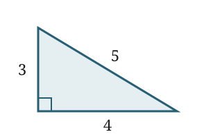

# Headings and table of contents

Use Markdown headings to create numbered sections and a table of contents. The current section is highlighted as you scroll.

::: example
## A subsection

Ordinary **bold**, *italic*, and `code` work as expected.
:::

# Math

Use dollar signs for inline math and double dollar signs for display equations. Give an equation an ID to number it and refer to it later.

::: example
Inline math: $x^2 + y^2$.

$$
(x + 1)^2 = x^2 + 2x + 1
$$ {#eq:square}
:::

# Statements and proofs

Theorems, lemmas, definitions, and the other common statements are numbered for you, and the config can add more. Proofs get an end marker automatically.

::: example
::: lemma {#lem:square title="A square"}
For every real $x$, $(x+1)^2 = x^2 + 2x + 1$.
:::

::: proof {#proof:square}
Expand the product and collect terms.
:::
:::

# Tables

Wrap a Markdown table in a table block to add a number, caption, and reference.

::: example
::: table {#tab:squares}
| $x$ | $x^2$ |
| --- | --- |
| 1 | 1 |
| 2 | 4 |
| 3 | 9 |
Caption: The first three squares.
:::
:::

# Cross-references

Write an element's ID after `@` to insert a reference link. Hover over a lemma, proof, equation, table, or figure reference to preview that block.

::: example
See @eq:square, @lem:square, @proof:square, and @tab:squares.
:::

# Figures

Put a Markdown image inside a figure container to give it a number, caption, and reference. Local PNG, JPEG, SVG, GIF, WebP, and AVIF images are embedded in the HTML so it can travel as one file.

::: example
::: center {#fig:triangle}

Caption: An image included from a local file.
:::

See @fig:triangle.
:::

Image paths are relative to the Markdown file; remote image URLs keep their network dependency. Plugins can also draw figures directly, as in this SVG bar chart.

::: example
::: center {#fig:bars}
`bars:3,7,5`
Caption: A figure drawn by a plugin.
:::

See @fig:bars.
:::

# Sidenotes

Put a note marker in the text and define its contents elsewhere. The first reference displays the numbered note beside the text.

```markdown
An observation with a little extra detail.[^detail]

[^detail]: Notes stay beside the text, in the margin.
```

An observation with a little extra detail.[^detail]

[^detail]: Notes stay beside the text, in the margin.

# Citations

Use a bibliography key to cite an entry from a BibTeX file. Cited entries appear in the references section at the end of the document, and hovering a citation previews its entry.

::: example
A citation to a sample entry: [@example2026], or a page of it: [@example2026, p. 3].
:::

The corresponding entry in `refs.bib` is:

```bibtex
@article{example2026,
  author = {Author, A.},
  title = {A sample bibliography entry},
  journal = {Example Journal},
  year = {2026}
}
```

# Interactive plugins

Plugins can add document blocks and browser behavior. This demo's square block embeds a slider; try moving it.

::: example
::: square
:::
:::

The bars, slider, and source/result panels are implemented in the demo's [example plugin](https://github.com/lfrati/folio/tree/main/examples/showcase/plugins). They illustrate the extension API and can be replaced with your own widgets.

# AI drafts

Agents wrap their proposed text in an AI block, which stays visibly marked until you accept it. The label, red text, and left marker identify the passage as an AI draft.

::: example
::: ai
This paragraph was drafted by an AI agent.
::: endai
:::

# Try it

Create a minimal project with a Hello, world document and agent instructions:

```sh
npx --yes --ignore-scripts --min-release-age=14 --allow-git=all --package=github:lfrati/folio#v0.4.0 folio init my-paper
cd my-paper
npm install
npm run build
```

Edit `paper.md` and open the generated `paper.html`. Use `npm run watch` to rebuild while writing; the generated `AGENTS.md` explains how agents should mark their drafts.

Build this showcase with `npm run build:demo` in the [Folio repository](https://github.com/lfrati/folio). The resulting `examples/showcase/index.html` is a single file ready to open locally or serve as a website.
